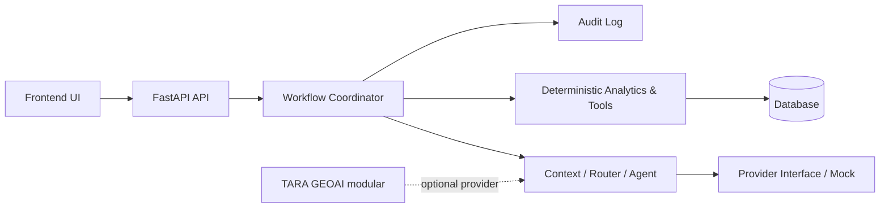

# TARA AGENT — Architecture

## Stack decision
MVP memakai **FastAPI + Python 3.11**, frontend HTML statis yang dapat diganti Next.js, dan SQLite lokal sebagai default. FastAPI dipilih karena cocok untuk deterministic analytics, type validation, dan pengujian cepat. PostgreSQL/Supabase menjadi target saat persistence multi-user diperlukan. LLM memakai interface provider dengan `mock` sebagai default; tidak ada API key palsu.

## Workflow
- Informational: Input → Context Check → Task Routing → Read Business Data → Deterministic Query/Calculation → Business Answer.
- Diagnostic: Input → Context Check → Task Routing → Read Business Data → Diagnose → Evidence Validation → Finding & Explanation.
- Goal-Directed: routing → readiness/diagnosis → options → simulation → predictive monitoring → constraint gate/evaluation → decision → user selection → approval → action → actual monitoring → control → feedback.

Approve requires an approver and transitions to executing. Reject and Revise return to diagnosing. Action must not execute without approval; external campaign publishing is not implemented. Event/case IDs and persistent audit records are planned for the database layer.

## Modules
`analytics` owns deterministic calculations; `constraints` owns hard gates; `workflows` owns state; `agent` owns provider abstraction. Planned boundaries include ingestion, simulation, monitoring, auth/RBAC, audit, and database repositories.

## Governance and open decisions
Human approval remains mandatory for high-impact actions. Input validation exists at API/model and calculation boundaries. GeoAI, POS, Maps, Weather, notification, authentication, PostgreSQL, and production LLM provider remain unconfigured and must not be represented as active integrations.
