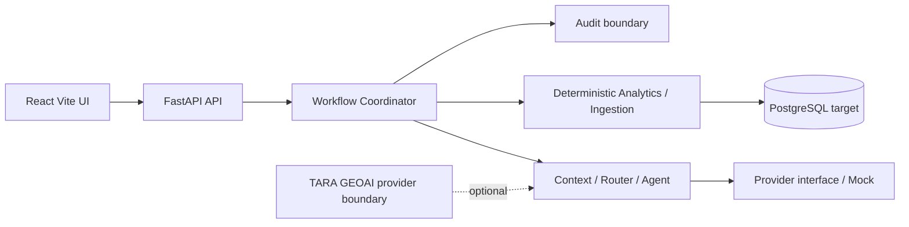

# TARA AGENT — Architecture

## Stack decision
MVP menggunakan **React + Vite + TypeScript** untuk frontend dan **FastAPI + Python 3.11** untuk backend. Frontend dipilih untuk UI modular dan TypeScript; FastAPI mendukung validasi API serta deterministic analytics. PostgreSQL adalah target database, tetapi persistence SQLAlchemy/Alembic belum dipasang karena belum ada migration/data contract yang siap diuji. SQLite tetap menjadi konfigurasi lokal non-persisten.

## Core workflow
- Informational: Input → Context Check → Intent Routing → Read Business Data → Deterministic Query/Calculation → Business Answer.
- Diagnostic: Input → Context Check → Intent Routing → Read Business Data → Diagnose → Evidence Validation → Finding & Explanation.
- Goal-Directed: Routing → Readiness/Data → Understand/Diagnose → Explore Options → Simulate → Predictive Monitoring → Constraint Gate/Option Evaluation → Decision/Explanation → User Decision.

Approve validates the current foundation approval field and transitions to execution, but is not authentication or RBAC. Reject transitions to `reexecuting` for re-diagnosis and re-simulation. Revise requires `revision_parameters` and transitions to `revision_requested`; this is distinct from Reject. Persistent event identity and action packages remain planned. No external campaign publication exists.

## Module boundaries
- `analytics`: deterministic financial calculations.
- `constraints`: hard constraint evaluation; LLM cannot bypass it.
- `workflows`: typed workflow state and decision transitions.
- `data_ingestion`: controlled CSV validation and invalid-row report.
- `agent`: provider abstraction with explicit mock mode.
- `geoai`: typed location context interface with source, observation, coverage, limitations, and confidence.

Planned boundaries include context manager, intent router, planner, tool allowlist, repositories, authentication/RBAC, audit persistence, simulation, predictive monitoring, actual monitoring, and feedback.

## Security and governance
Secrets remain server-side. `VITE_API_BASE_URL` is non-secret frontend configuration. Approval is not considered authenticated authorization. Human approval remains required for high-impact action. Input errors return explicit HTTP errors. External POS, Maps, Weather, notification, and GeoAI integrations are not active.
